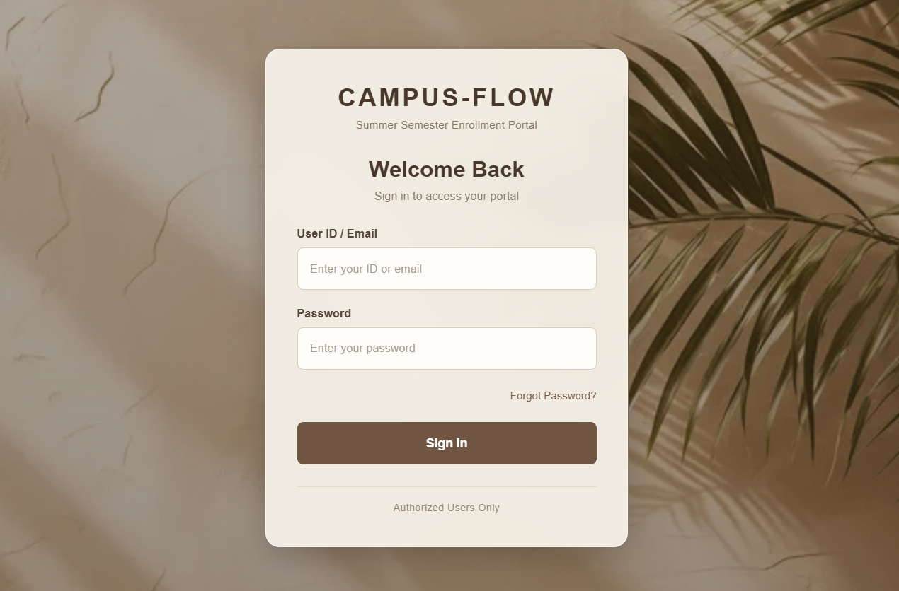
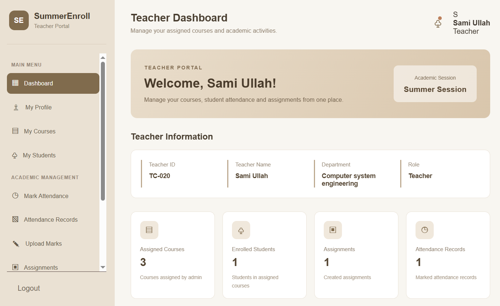
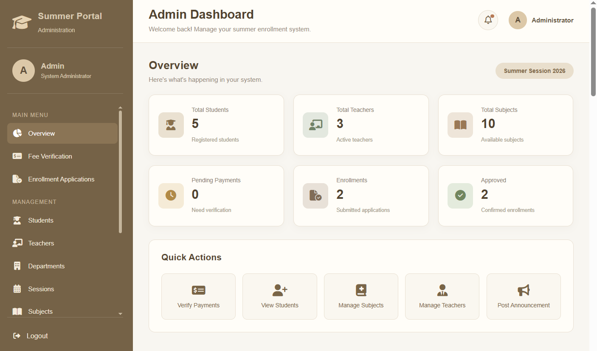

# CAMPUS-FLOW 🎓
### Summer Semester Enrollment Portal

CAMPUS-FLOW is a full-stack university enrollment portal designed to manage summer semester admissions and academic activities through separate dashboards for Students, Teachers, and Administrators.

The system simplifies course enrollment, fee verification, attendance management, assignment handling, and academic communication.

## 📌 Project Overview

CAMPUS-FLOW provides a centralized platform where students can enroll in summer courses, teachers can manage their academic activities, and administrators can oversee the enrollment process.

## ✨ Key Features

### 👨‍🎓 Student Dashboard
- Secure login using pre-created accounts.
- View available summer courses.
- Select courses according to enrollment rules.
- Automatic credit hour and fee calculation.
- Submit fee payment proof.
- Track fee verification and enrollment status.
- View notifications and announcements.
- Check attendance and assignments.
- Access timetable and assigned teachers after enrollment approval.

### 👩‍🏫 Teacher Dashboard
- View assigned courses.
- Mark student attendance as Present or Absent.
- Upload course assignments.
- View student assignment submissions.
- Publish course announcements.
- Access course-related information.

### 🛠️ Admin Dashboard
- Manage student and teacher records.
- Manage courses and academic sessions.
- Assign teachers to courses.
- Verify student fee payment proofs.
- Send notifications and announcements.
- Manage teacher active/inactive status.

## 🖥️ Screenshots

### 1. Login Page


### 2. Student Dashboard


### 3. Teacher Dashboard


### 4. Admin Dashboard


## 🧰 Technologies Used

| Frontend | Backend | Database |
|---|---|---|
| HTML5 | Node.js | MySQL |
| CSS3 | Express.js | MySQL Workbench |
| JavaScript | REST APIs | |
 
Other Tools:
- Git and GitHub
- VS Code
- Multer for file uploads
- dotenv for environment configuration

## 📂 Project Structure

```text
CAMPUS-FLOW/
│
├── backend/
│   ├── routes/
│   │   ├── admin-api.js
│   │   ├── auth.js
│   │   ├── student-api.js
│   │   └── teacher-api.js
│   ├── db.js
│   ├── seed-users.js
│   └── server.js
│
├── css/
├── database/
│   └── campus_flow_db.sql
├── html/
├── images/
├── js/
├── screenshots/
├── .gitignore
├── package.json
└── README.md
```

## ⚙️ Installation and Setup

### 1. Clone the Repository

```bash
git clone https://github.com/YOUR-USERNAME/CAMPUS-FLOW.git
cd CAMPUS-FLOW
```

### 2. Install Dependencies

```bash
npm install
```

### 3. Set Up MySQL Database

1. Open MySQL Workbench.
2. Create a database named `campus_flow_db`.
3. Import `database/campus_flow_db.sql`.
4. Make sure all tables are created successfully.

### 4. Configure Environment Variables

Create a `.env` file in the root directory:

```env
DB_HOST=localhost
DB_USER=root
DB_PASSWORD=your_mysql_password
DB_NAME=campus_flow_db
```

Replace the password with your own local MySQL password.

### 5. Start the Application

```bash
node backend/server.js
```

Open your browser:

```text
http://localhost:3000
```

## 🔐 Security

- Database credentials are stored in environment variables.
- `.env` is excluded from GitHub.
- Uploaded files and `node_modules` are excluded.
- Demo data is used for project demonstration.

## 🎯 Project Purpose

This project was developed as a Software Engineering practice project to gain practical experience in:

- Full-stack web development.
- Node.js and Express.js backend development.
- MySQL database integration.
- API development and routing.
- Role-based dashboards.
- File upload handling.
- Git and GitHub version control.

## 🚀 Future Improvements

- Online deployment.
- Automated testing.
- Enhanced security and validation.
- Improved accessibility and responsive design.

## 👩‍💻 Author

**Aqsa Ishfaq**

BS Software Engineering Student

GitHub: [@aqsaishfaq07](https://github.com/aqsaishfaq07)

---

⭐ If you find this project useful, consider giving it a star!

